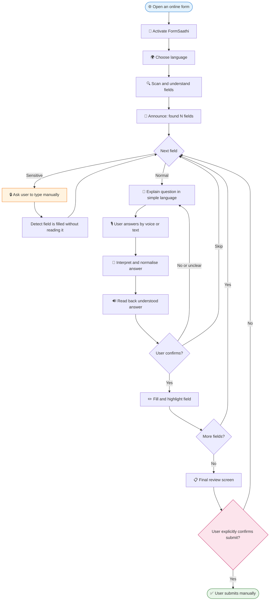
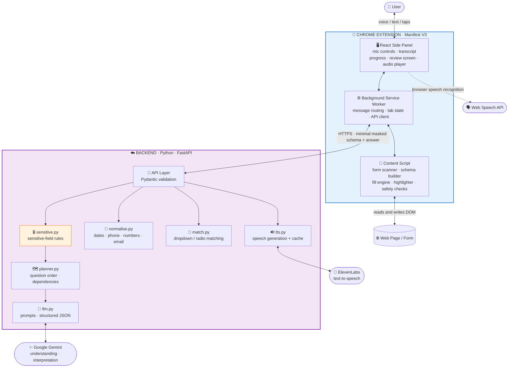
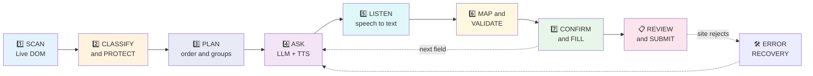
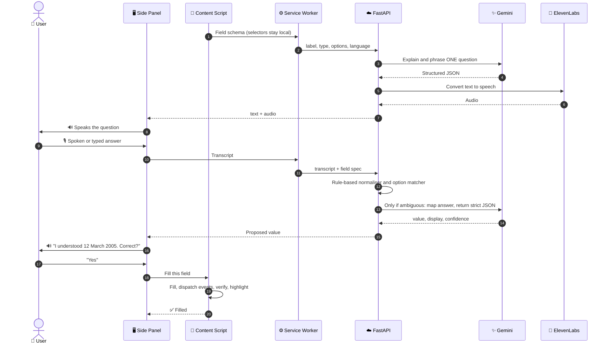
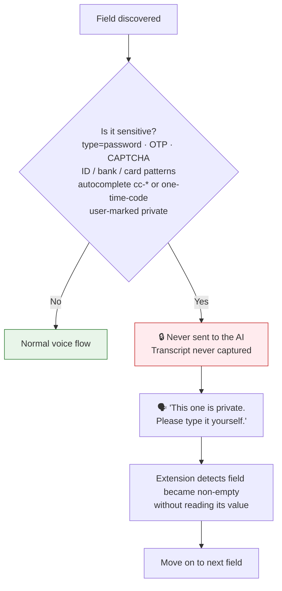
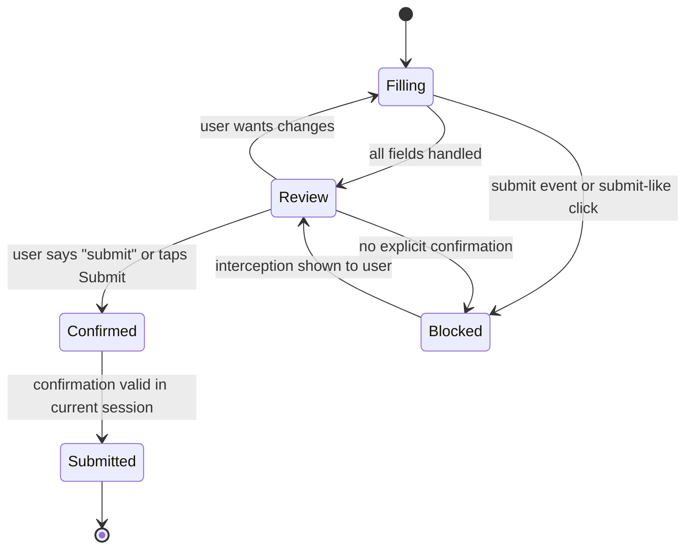
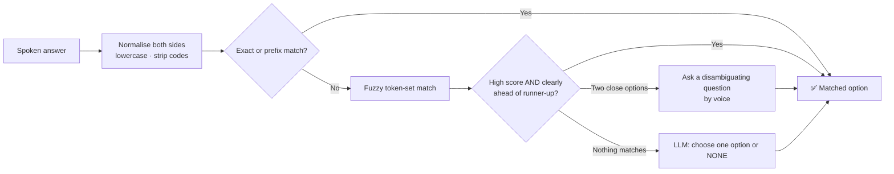
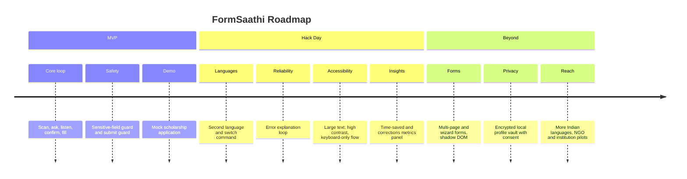

<div align="center">

# 🎙️ FormSaathi

### Your forms. Your language. Your control.

**A voice-first Chrome extension that talks you through any confusing online form, fills it from your spoken answers, and never submits until *you* say so.**

<br/>


**[Problem](#-the-problem) · [Solution](#-the-solution) · [Demo Flow](#-demo-flow) · [Architecture](#-system-architecture) · [Tech Stack](#-tech-stack) · [Safety](#-safety-privacy--trust) · [Run it](#-getting-started) · [Team](#-team-hacksmith)**

</div>

---

## 📌 TL;DR

> Millions of people abandon, mis-fill or pay middlemen to complete online forms, because the forms are jargon-heavy, English-first and unforgiving.
> **FormSaathi** sits beside the form, explains each field in plain language, listens to the user's answer, repeats what it understood, and fills the field **only after the user confirms**.
> Passwords, OTPs and ID numbers **never reach the AI**. The form is **never submitted without explicit human approval**.

---

## 🧩 The Problem

Scholarship applications, college admissions, bank accounts, certificates and government services all live behind long digital forms. For many people these forms are hard in three ways:

| Barrier | What it looks like | Consequence |
|---|---|---|
| 🗣️ **Language** | Forms are mostly English; users think in Kannada, Hindi or other regional languages | Misunderstood questions, wrong answers |
| 📖 **Jargon** | "Domicile", "annual family income", "category certificate no." | Users guess, or leave fields blank |
| ⌨️ **Digital comfort** | First-time internet users, elderly users, low-vision users, low typing skill | Abandoned applications, dependence on cyber cafés and agents |

A single wrong date format or dropdown choice can get an application rejected, and people often find out only after the deadline.

### Why existing tools don't solve it

| Capability | Browser Autofill | Screen Reader | AI Chat (copy-paste) | General AI Browser Agent | **FormSaathi** |
|---|:---:|:---:|:---:|:---:|:---:|
| Explains unfamiliar fields | ❌ | ❌ | ✅ | Partly | ✅ per field |
| Works inside the page | ✅ | ✅ | ❌ | ✅ | ✅ |
| Fills fields from spoken answers | ❌ | ❌ | ❌ | Partly | ✅ |
| Regional-language voice conversation | ❌ | Limited | Limited | Rarely | ✅ |
| Sensitive-data guard | Partly | n/a | ❌ | Rarely | ✅ |
| Submits only with user confirmation | n/a | n/a | n/a | Varies | ✅ **Always** |

> Competitor capabilities change quickly; this table reflects the design goals of FormSaathi against common categories of tools.

---

## 💡 The Solution

FormSaathi is a **voice-first browser assistant** that works alongside online forms and keeps the human in control.

<table>
<tr>
<td width="50%">

### 🔍 Understands any standard form
Scans the page and builds a structured schema of every field: label, type, required flag, options, validation hints. **No per-site scripts.**

### 🗨️ Explains in simple language
Each question is explained in plain words, in the user's chosen language.

### 🎙️ Talks and listens
Asks one question at a time via ElevenLabs voice. Users answer by speaking or typing.

</td>
<td width="50%">

### 🧠 Smart answer mapping
"Twelve March two thousand five" becomes `12/03/2005`. A spoken "Karnataka" matches the option `KARNATAKA - 29`.

### ✅ Confirm before fill
Reads back what it understood. Fills and highlights the field only after approval.

### 🛡️ Privacy and submit guard
Sensitive fields are skipped ("please type this one yourself"). Submission is blocked until the user explicitly confirms.

</td>
</tr>
</table>

---

## 🎬 Demo Flow

> *A student opens a scholarship application with 14 fields.*

```text
🤖  "I found 14 fields in this application. Let's complete them one by one.
     You can say 'skip' or 'repeat' at any time."

🤖  "Your date of birth, as written on your 10th marksheet. Please say day, month and year."
🧑  "Twelve March two thousand five."
🤖  "I understood 12 March 2005. Is that correct?"
🧑  "Yes."
✅  Field filled and highlighted.

🤖  "This one is private. Please type your Aadhaar number yourself, then press Next."
🧑  (types it manually, the AI never sees it)

🤖  "All fields are done. Here is your review. Shall I submit?"
🧑  "Submit."   ← only now does submission proceed
```

### Voice commands supported at any point

`repeat` · `skip` · `go back` · `change <field>` · `explain more` · `stop`

---

## 🔄 User Flow



---

## 🏗️ System Architecture

The extension owns everything that touches the page. The backend owns reasoning, voice and secrets, so **API keys never live in the browser**, and the **raw page is never uploaded**.



### Why this split?

| Layer | Owns | Why |
|---|---|---|
| **Content Script** | DOM reading, filling, highlighting | The only part that can see and change the page |
| **Service Worker** | Routing and API communication | Decouples page, UI and network |
| **Side Panel** | Conversation UI, mic, review | Persistent surface that doesn't disturb the form |
| **Backend** | AI reasoning, voice, secrets | Keys stay server-side; sensitive data is filtered before any model call |

---

## ⚙️ End-to-End Pipeline



| # | Stage | Input | Processing | Output |
|---|---|---|---|---|
| 1 | **Scan** | Live DOM | Find controls, resolve labels, collect options and constraints | Raw field list |
| 2 | **Classify & Protect** | Raw field list | Tag semantic type, flag sensitive fields | Annotated schema |
| 3 | **Plan** | Annotated schema | Order fields, group related ones, detect dependencies | Question plan |
| 4 | **Ask** | Next field | Explain and ask in the user's language, speak it | Audio + text prompt |
| 5 | **Listen** | User speech | Speech-to-text, language handling | Transcript |
| 6 | **Map & Validate** | Transcript + field spec | Normalise, match options, validate, score confidence | Proposed value |
| 7 | **Confirm & Fill** | Proposed value | Read back, user confirms, fill, highlight, rescan | Filled field |

---

## 🔁 One Question, One Turn (Sequence)



---

## 🛡️ Safety, Privacy & Trust

> **Privacy and safety are part of the product architecture, not optional add-ons.**

### Sensitive-field guard



### Submit guard (the central trust guarantee)



### Threat model

| Threat | Mitigation |
|---|---|
| 🔑 Sensitive data leaks to the LLM or logs | Sensitive-field guard; values dropped before any network call; no transcripts captured for sensitive fields |
| 💉 Prompt injection through page content | Page text treated as untrusted **data**; LLM returns only a fixed JSON schema; the agent has no tool to click arbitrary elements or submit |
| 📤 Wrong data submitted silently | Echo-and-confirm per value, full review screen, submit guard |
| 🎣 Phishing or malicious forms | Page host shown in the side panel; warning on payment or PIN requests; no autofill on pages the user hasn't activated |
| 🗝️ API key theft | Keys live only on the backend; extension uses a short-lived session token |
| 🗄️ Data retention | Sessions expire automatically; no form values stored server-side after the session |
| 🔐 Over-broad extension permissions | Minimal permissions (`activeTab`, `scripting`, `sidePanel`, `storage`), runs only on the tab the user activates |

### Consent and transparency

A first-run screen states clearly **what is sent** (field labels and non-sensitive answers) and **what is never sent** (passwords, OTPs, ID numbers, the raw page).

---

## 🧠 Under the Hood: Key Algorithms

<details>
<summary><b>🔍 1. Form scanning and label resolution</b></summary>

1. Select candidates: `input`, `select`, `textarea`, and ARIA roles (`textbox`, `combobox`, `radio`, `checkbox`).
2. Skip hidden, disabled and read-only controls.
3. Resolve the label in priority order:
   `<label for>` / wrapping label → `aria-labelledby` / `aria-label` → `placeholder` / `title` → nearest preceding text → `name`/`id` split on camelCase and underscores.
4. Group radios and checkboxes by `name`; group label from `fieldset > legend` or nearest heading.
5. Collect options and constraints (`required`, `maxlength`, `min`, `max`, `pattern`, hints via `aria-describedby`).
6. Attach a `MutationObserver` so fields that appear later (for example after choosing a State) join the plan.

</details>

<details>
<summary><b>🏷️ 2. Semantic field classification</b></summary>

Every field gets a `semantic_type` from a fixed taxonomy:
`full_name`, `first_name`, `last_name`, `date_of_birth`, `gender`, `email`, `phone`, `address_line`, `city`, `state`, `pincode`, `percentage`, `year`, `amount`, `yes_no`, `free_text`, `id_number`, `password`, `otp`, `captcha`, `file_upload`, `other`.

**Two layers:** deterministic rules first (keywords, regex, `autocomplete`, input type), then one batched LLM call only for fields still marked `other`.

</details>

<details>
<summary><b>🔧 3. Deterministic answer normalisation (before any LLM)</b></summary>

| Type | Method |
|---|---|
| Date | Parse spoken or typed dates, output in the format required by `pattern` / placeholder |
| Phone | Strip fillers, convert number words to digits, validate length |
| Pincode | Convert to digits, validate 6 digits |
| Number / percentage / amount | Number words to digits, handles "point", "lakh", "crore" |
| Email | "at" → `@`, "dot" → `.`, always read back letter by letter |
| Name | Title-case, keep spelling as heard, spell-back confirmation |
| Gender, yes/no, radio, checkbox | Matched against the option list |

Rules are faster, cheaper and more predictable than the LLM, so they run first.

</details>

<details>
<summary><b>🎯 4. Dropdown and radio option matching</b></summary>



Example: "Karnataka" matches `KARNATAKA - 29`.

</details>

<details>
<summary><b>🧪 5. Strict structured LLM output + confidence policy</b></summary>

The model is called with the field spec, the transcript and a required JSON schema `{ value, display, confidence, issues[] }`. Output is validated by **Pydantic**; invalid or low-confidence output is **never filled**, and the agent re-asks. The model is instructed to **never invent a value the user did not say**.

| Confidence | Field risk | Behaviour |
|---|---|---|
| High (≥ 0.9) | Low (city, free text) | Echo briefly, fill unless user says "no" |
| High | High (name, DOB, phone, email, amount) | Echo and require explicit "yes" |
| Medium / low | Any | Ask a clarifying question or ask to repeat |

For the MVP, **every value is echoed and confirmed**, which is the simplest and safest policy.

</details>

<details>
<summary><b>✏️ 6. Fill engine (works with React / Angular forms)</b></summary>

Modern frameworks ignore plain `element.value = x`. The fill engine sets values the way a user would so framework state updates:

```ts
function setNativeValue(el: HTMLInputElement, value: string) {
  const proto = Object.getPrototypeOf(el);
  const setter = Object.getOwnPropertyDescriptor(proto, 'value')!.set!;
  setter.call(el, value);
  el.dispatchEvent(new Event('input',  { bubbles: true }));
  el.dispatchEvent(new Event('change', { bubbles: true }));
  el.dispatchEvent(new Event('blur',   { bubbles: true }));
}
```

- **Select:** set the matching option, dispatch `change`.
- **Radio / checkbox:** call `click()` so site handlers fire.
- **Date:** ISO format for `type=date`, site-expected string for text dates.
- **Verify:** read the value back; retry once; otherwise ask the user to enter it.
- **Highlight:** outline the filled field and scroll it into view (helps low-vision users).

</details>

<details>
<summary><b>🛠️ 7. Error recovery</b></summary>

When the site shows validation errors (`aria-invalid`, error classes, new text near fields), the agent collects the error text, asks the LLM to explain it in plain language with a proposed fix, reads it out, and re-asks **only** the affected field.

</details>

<details>
<summary><b>🌍 8. Multilingual handling</b></summary>

The user picks a language at the start, and mixed speech (for example Kannada with English words) is accepted. Explanations use the user's language; **values written to the form stay in the language the site expects**. Well-known form terms such as "Aadhaar" are kept unchanged.

</details>

<details>
<summary><b>⚡ 9. Latency optimisation</b></summary>

Target: **about 2.5 seconds** from end of speech to next spoken question.

- **Prefetch** the next question's text and audio while the user answers.
- **Cache audio** keyed by `hash(text + language + voice)`; static prompts are generated once.
- **Batch** LLM calls (classify all unknown fields at once, pre-generate the next 2–3 questions).
- **Prefer rules over LLM** for normalisation.
- **Stream audio** to the side panel when supported.

</details>

---

## 🧰 Tech Stack

### 🧩 Browser Extension

| Technology | Role | Why we chose it |
|---|---|---|
| **Chrome Extension Manifest V3** | Extension platform | Runs where the form lives; side panel suits a persistent conversation |
| **React** | Side panel UI | Fast to build, component-driven |
| **TypeScript** | Type safety across scanner, fill engine and UI | Safer DOM work, shared types for the field schema |
| **Tailwind CSS** | Styling | Large controls and high contrast for accessibility |
| **Chrome Extensions API** | `sidePanel`, `scripting`, `activeTab`, `storage`, messaging | Minimal-permission architecture |
| **DOM APIs + MutationObserver** | Scanning, filling, detecting dynamic fields | Works on forms never seen before |

### ☁️ Backend

| Technology | Role | Why we chose it |
|---|---|---|
| **Python** | Backend language | Rich ecosystem for NLP and AI |
| **FastAPI** | API framework | Fast, async, auto-generated API docs |
| **Pydantic** | Request, response and LLM-output validation | Strict schemas stop malformed AI output reaching the form |
| **RapidFuzz** *(or similar)* | Fuzzy option matching | Matches dropdowns without LLM calls |

### 🤖 AI and Voice

| Technology | Role | Why we chose it |
|---|---|---|
| **Google Gemini** | Question understanding, answer interpretation, error explanation | Reliable structured JSON, multilingual understanding |
| **ElevenLabs TTS** | Natural multilingual voice output | Voice is the primary interface, not a decoration |
| **Web Speech API** | Browser speech recognition (primary) | Free and low latency |
| **ElevenLabs STT** *(fallback)* | Noisy audio or weak-language recognition | Robust fallback path |

### 🏗️ Cloud (deployment target)

| Service | Use |
|---|---|
| **AWS API Gateway + Lambda** | HTTPS entry and serverless FastAPI orchestrator, with per-session rate limiting |
| **AWS S3** | Audio cache with lifecycle expiry; content-hash keys so no personal data is in object names |
| **AWS DynamoDB** | Session state with TTL auto-expiry |
| **AWS Secrets Manager** | LLM and TTS API keys |
| **AWS CloudWatch** | Latency and error metrics; **no form values in logs** |

### 🧪 Tooling

| Tool | Use |
|---|---|
| **GitHub** | Version control and collaboration |
| **Playwright** | Automated scan-and-fill tests on the mock form |
| **Mock scholarship form** | Reproducible end-to-end demo target |

---

## ✨ Feature Checklist

| Feature | Description | MVP |
|---|---|:---:|
| Form detection | Standard HTML fields: text, number, date, select, radio, checkbox, textarea | ✅ |
| Simple explanations | Complicated questions rewritten in plain language | ✅ |
| Voice interaction | Answer by speaking | ✅ |
| Text input | Fallback when voice is unavailable | ✅ |
| Smart answer mapping | Normalises formats and matches options | ✅ |
| Confirmation before filling | Shows the interpreted answer and waits for approval | ✅ |
| Field highlighting & progress | Highlights completed fields, tracks progress | ✅ |
| Sensitive field protection | Skips sensitive fields, asks for manual entry | ✅ |
| Application review | Final review before manual submission | ✅ |
| Submit protection | No submission without explicit confirmation | ✅ |
| Error explanation loop | Explains site validation errors | 🔜 |
| Additional Indian languages | Language-switch command | 🔜 |

---

## 📁 Project Structure

```text
FormSaathi/
│
├── extension/                    # 🧩 Chrome Extension (Manifest V3)
│   ├── public/
│   │   └── manifest.json
│   ├── src/
│   │   ├── background/
│   │   │   └── worker.ts         # message routing · tab state · API client
│   │   ├── content/
│   │   │   ├── scanner.ts        # DOM scan · label resolution · schema builder
│   │   │   └── fill.ts           # fill engine · highlighter · submit guard
│   │   ├── sidepanel/            # React UI: conversation · mic · audio · review
│   │   │   ├── components/
│   │   │   ├── pages/
│   │   │   ├── hooks/
│   │   │   ├── services/
│   │   │   └── styles/
│   │   └── shared/               # shared types and field-schema contract
│   ├── package.json
│   └── tsconfig.json
│
├── backend/                      # ☁️ FastAPI backend
│   ├── app/
│   │   ├── main.py               # API entry point
│   │   ├── planner.py            # question order · dependencies
│   │   ├── normalise.py          # dates · phone · numbers · email
│   │   ├── match.py              # dropdown / radio matching
│   │   ├── llm.py                # Gemini prompts · structured output
│   │   ├── tts.py                # ElevenLabs text-to-speech
│   │   └── sensitive.py          # sensitive-field rules
│   ├── requirements.txt
│   └── .env.example
│
├── demo/
│   └── scholarship-form/         # 🎓 mock form for reproducible demos
│
├── docs/
│   └── architecture.md
│
├── .gitignore
└── README.md
```

---

## 🔌 API Contract

### Field schema (sent from extension to backend)

```json
{
  "page": { "url_host": "example.gov.in", "title": "Scholarship Application", "lang": "en" },
  "fields": [
    {
      "id": "f3",
      "label": "Date of Birth",
      "help_text": "Format DD/MM/YYYY",
      "input_type": "date",
      "semantic_type": "date_of_birth",
      "required": true,
      "pattern": "\\d{2}/\\d{2}/\\d{4}",
      "options": null,
      "sensitive": false,
      "depends_on": null
    }
  ]
}
```

> The CSS `selector` **stays inside the extension**. Only the label, hint, type, semantic type, required flag, pattern and options are sent.

### `POST /v1/session/{id}/next-question`

```json
// request
{ "field": { "...schema entry..." }, "language": "kn-IN", "history_summary": "name, gender filled" }

// response
{
  "text": "Your date of birth, as written on your 10th marksheet. Please say day, month and year.",
  "audio_url": "https://.../audio/9f2c1a.mp3",
  "expects": "date"
}
```

### `POST /v1/session/{id}/answer`

```json
// request
{ "field_id": "f3", "transcript": "twelve March two thousand five", "language": "en-IN" }

// response
{
  "value": "12/03/2005",
  "display": "12 March 2005",
  "confidence": 0.97,
  "needs_confirmation": true,
  "issues": []
}
```

---

## 🚀 Getting Started

> ⚠️ The project is in active MVP development. Commands below follow the planned structure, so adjust if scripts differ.

### Prerequisites

- Google Chrome (recent version with Side Panel support)
- Node.js 18+ and npm
- Python 3.10+
- API keys for **Google Gemini** and **ElevenLabs**

### 1️⃣ Clone

```bash
git clone https://github.com/vrajardeshana19-bit/FormSathi.git
cd FormSathi
```

### 2️⃣ Run the backend

```bash
cd backend
python -m venv venv
source venv/bin/activate          # Windows: venv\Scripts\activate
pip install -r requirements.txt
cp .env.example .env              # then add your keys (never commit .env)
uvicorn app.main:app --reload
```

`.env` keys:

```env
GEMINI_API_KEY=your_gemini_key
ELEVENLABS_API_KEY=your_elevenlabs_key
```

Interactive API docs are available at `http://localhost:8000/docs`.

### 3️⃣ Build and load the extension

```bash
cd extension
npm install
npm run build
```

1. Open `chrome://extensions`
2. Enable **Developer mode**
3. Click **Load unpacked** and select the built extension folder

### 4️⃣ Try it

1. Open the mock form in `demo/scholarship-form/`
2. Click the **FormSaathi** icon to open the side panel
3. Pick a language and start the voice conversation

---

## 🧪 Testing & Evaluation

| Metric | How measured |
|---|---|
| Field detection accuracy | % of fillable fields found with the correct label across test forms |
| Fill accuracy | % of values matching the intended answer after fill |
| Turns per field | Average exchanges needed to fill a field |
| End-to-end latency | End of speech to start of next prompt audio |
| Task completion time | Mock form with FormSaathi vs unaided |
| **Safety checks** | **Zero** sensitive values in logs or network payloads · **zero** submissions without confirmation |

Test set: the mock form, several public forms of different styles, and recorded spoken answers with accents and background noise. Playwright automates scan-and-fill tests.

---

## 🎯 Impact

| Who benefits | How |
|---|---|
| 🎓 Students applying for scholarships and exams | Fewer rejected applications from format errors |
| 👵 Elderly and first-time internet users | Hands-light, conversational experience |
| 👁️ Low-vision and low-literacy users | Voice in, voice out, highlighted fields |
| 🏢 NGOs, Common Service Centres, college help desks | Faster, more consistent assisted form-filling |

**Scalability:** no per-site integration is needed, and adding a language is mostly a prompt and voice configuration change.

**Business model:** free for individuals; institutional plans for kiosks, colleges and NGOs (usage dashboard, more languages, white-label); B2B licence for organisations embedding the assistant on their own forms.

---

## 🗺️ Roadmap



---

## 👥 Team HackSmith

> Four builders, one product. Every member owns a core pillar of FormSaathi, shipping across the stack together.

<div align="center">

| Vraj Ardeshana | Yuktha P | S. Lethesh Sudhakar | Ruchi Kalpesh Joshi |
|:---:|:---:|:---:|:---:|
| [@vrajardeshana19-bit](https://github.com/vrajardeshana19-bit) | [@yukthaprakash](https://github.com/yukthaprakash) | [@letheshsudhakar-wq](https://github.com/letheshsudhakar-wq) | [@ruchijoshi1908](https://github.com/ruchijoshi1908) |
| Co-Creator | Co-Creator | Co-Creator | Co-Creator |
| 🧩 Extension & DOM Engine | 🧠 Backend & AI Pipeline | 🎙️ Voice & Interaction | 🎨 UI/UX & Quality |

</div>

### 🧱 Shared pillars: equal ownership

| Pillar | Scope |
|---|---|
| 🧩 **Extension & DOM Engine** | Manifest V3 setup, form scanner, schema builder, fill engine, field highlighter, submit guard |
| 🧠 **Backend & AI Pipeline** | FastAPI architecture, Gemini integration, answer interpretation, normalisation, option matching, API docs |
| 🎙️ **Voice & Interaction** | ElevenLabs text-to-speech, speech recognition, conversation loop, voice commands |
| 🎨 **UI/UX & Quality** | Side panel design, review screen, accessibility, testing, demo form, documentation |

**All four members** contribute to architecture decisions, integration, testing, documentation and the final demonstration.

---

## 🌟 Contributors

<a href="https://github.com/vrajardeshana19-bit/FormSathi/graphs/contributors">
  
</a>

| Contributor | GitHub |
|---|---|
| Vraj Ardeshana | [vrajardeshana19-bit](https://github.com/vrajardeshana19-bit) |
| Yuktha P | [yukthaprakash](https://github.com/yukthaprakash) |
| S. Lethesh Sudhakar | [letheshsudhakar-wq](https://github.com/letheshsudhakar-wq) |
| Ruchi Kalpesh Joshi | [ruchijoshi1908](https://github.com/ruchijoshi1908) |

---

## ⚠️ Known Limitations (honest scope)

- MVP targets **standard HTML forms**; iframes, shadow DOM and multi-step wizards are on the roadmap.
- Speech recognition quality varies by language and accent, so typing fallback and read-back confirmation are always available.
- We do **not** automate login-protected government portals; demos run on our own mock form and public forms.

---

## 📜 License

Released under the MIT License. See `LICENSE` for details.

---

<div align="center">

### 🎙️ FormSaathi
**Your forms. Your language. Your control.**

*Making digital forms easier for everyone.*

Built with ❤️ by **Team HackSmith** · CMR Institute of Technology · wHACKiest 2026

</div>
